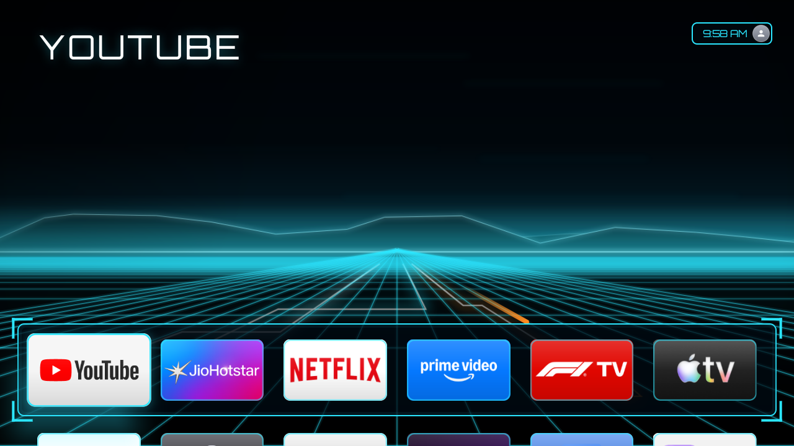
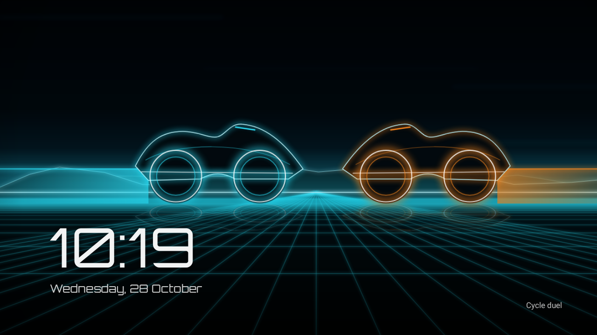

# Glass Launcher: a tvOS 26-style Home screen for Android TV

A Home screen for Android TV / Google TV laid out like Apple's tvOS 26, with two looks: Liquid
Glass, and **Grid**, a neon theme in the spirit of Tron: Legacy with its own generated wallpapers
and screensaver. Not affiliated with Apple or Disney; no Apple or film code, assets or branding
are used.

| Grid theme (Tron) | Glass Grid screensaver |
|---|---|
|  |  |
| **Glass theme: app grid** | **Glass context menu** |
|  |  |

*Screenshots from a Realme Android TV (Android 11, 1280×720).*

**[Download the APK from Releases](../../releases/latest)**, then see [Install it on the TV](#2-install-it-on-the-tv).

## Features

- **Full-screen Top Shelf.** Today's Tron wallpaper (or the focused app's own colours) fills the
  whole screen with a slow push-in, and the app's name appears as a big title in the top-left corner.
- **Clock + profile pill** in the top-right corner.
- **Liquid Glass dock.** The top row of 6 apps sits on a frosted rounded panel ~76% down the
  screen; the next row only just peeks in at the bottom.
- **5:3 rounded icons** with a glass rim and sheen. The focused icon grows 1.2×, lifts with a
  shadow, tilts the way you moved, and a specular highlight glides across it.
- **Press Up from the dock** to enter the Top Shelf: the apps slide away, left/right pages
  through the dock apps (page dots at the bottom), OK opens one, Down/Back returns.
- Going down into the grid slides the Top Shelf away; app names appear under the focused icon.
- **Hold OK** (or press Menu) on an app for a glass context menu: Edit Home Screen, Move to Top
  Row, App Info, Hide from Home Screen, Delete App.
- **Hold OK on Settings** for: Rearrange Apps, Glass Launcher Settings, Show Hidden Apps, Reset Layout.

### Rearranging apps (Edit Home Screen)
Every icon wiggles, like tvOS. Browse with the arrows, **OK picks an app up**, the arrows carry it
(up/down jump a whole row, so any app can go straight into the top dock), **OK drops it**, then pick
up the next one. **Back** finishes and saves. Open it from any of:
- hold OK on an app → **Edit Home Screen** (starts with that app picked up), or **Move to Top Row**;
- hold OK on the **Settings** icon → **Rearrange Apps**;
- **Glass Launcher Settings → Home screen → Rearrange apps**.

### Ad blocking
**Glass Launcher Settings → Ad blocking.** Switches Android's built-in Private DNS (DNS-over-TLS) to
AdGuard's free DNS, so ad and tracker servers are blocked for every app on the TV, with no VPN or extra
app. Options: ads + trackers, ads + trackers + adult sites (AdGuard Family), or off. Glass checks
that a test ad server is blocked and that the internet still works. If your network blocks
secure DNS, it switches itself back off. DNS blocking can't remove YouTube/Netflix in-video ads,
which are served from the same servers as the videos.

### Grid theme (Tron)
**Glass Launcher Settings → Theme and screensaver → Theme: Grid.** Black and neon, in the spirit of
Tron: Legacy:
- an animated neon **grid floor** flowing toward you, a glowing horizon, and **light cycles**
  (cyan and orange) racing down the lanes;
- icons with a cyan **light-line edge** that glows when focused; a dark dock with a light-line
  border and corner brackets; neon clock pill, menus and hints;
- **Orbitron** lettering for the title and clock.

The other theme, **Glass**, is the tvOS 26 Liquid Glass look.

### Tron wallpapers and the Grid screensaver
Glass **draws its own Tron-style wallpapers on the TV**: no downloads and no film images. There's a
different set every day, in a different order with different layouts:
*Light cycle* · *Cycle duel* · *Light jet* · *Patrol craft* · *Light cycles* · *The Grid at dusk* ·
*Identity disc* · *Neon city* · *The portal*.

- **Home background:** today's wallpaper fills the Top Shelf behind the app name. The live grid
  floor runs on top and continues its horizon. Switch: *Daily Tron wallpaper on the Home screen*.
- **Glass Grid screensaver:** today's wallpapers, each for 40 seconds with a slow drift, plus the
  time and date in Orbitron. Set it with *Use the Grid screensaver*, or in Settings → Device
  Preferences → Screen saver → **Glass Grid**. *Preview the screensaver* shows it right away.
- **Your own wallpapers:** send pictures with LocalSend into a folder named **Tron** (or
  **Wallpapers**), e.g. `Download/Tron`, then press *Let Glass show your own wallpapers*. They're
  shown first, in a new order each day.

### Lock as main launcher + remove bloatware
Open **Glass Launcher Settings** (it opens by itself on first launch, or hold OK on Settings):

- **Lock Glass as the main launcher.** Sets Glass as the default Home app, disables the original
  launcher (Google TV / Android TV Home), and turns on **Home Guard**.
- **Home Guard** (an accessibility service) sends the remote's Home button to Glass and closes
  the original launcher whenever anything brings it back (boot, shortcuts, apps).
- **Remove bloatware.** Tick preinstalled apps and press *Disable selected apps*, or press
  **Select recommended** first. Apps are *disabled*, not deleted: *Restore apps* brings them all
  back, even ones disabled from a PC. Entries marked "Warning" turn off a feature (voice search,
  casting, phone remote).
  *Recommended* entries (content-recognition tracking such as Anoki ACR, ad channels, partner
  auto-installs, vendor stores, setup leftovers) and the **keep-list** come from
  [cleanyourtv](https://github.com/Gathin23/cleanyourtv) (MIT)'s tested lists for AI PONT TVs, the
  Changhong/MediaTek platform used by realme, CHiQ, RCA and others. Parts that Live TV, HDMI inputs
  and the remote need (`com.mediatek.*`, `com.mstar.*`, `partnercustomizer`, firmware updater, key
  service) are never listed.
- **Restore the original launcher** undoes the lock.

These use the TV's own debugging connection (the same access as `adb shell` from a PC):
1. *Settings → Device Preferences (or System) → About*: press OK on **Build** 7 times.
2. *Developer options*: turn on **USB debugging** (and **Network debugging** if listed).
3. Press a button in Glass Launcher Settings and accept **Allow debugging?** (tick *Always allow*).

If it can't connect, your TV only offers *Wireless debugging*: from a PC run
`adb connect <TV-IP>` once, then `adb tcpip 5555`, and try again. Needs Android 8+.

Home Guard doesn't stop the remote's app shortcut buttons (Netflix, YouTube…) opening those apps.
It only makes sure that anything going "Home" lands on Glass.

---

## 1. Build the APK
- **Android Studio:** *File → Open* the `GlassLauncher` folder, then
  *Build → Build App Bundle(s) / APK(s) → Build APK(s)*. The APK appears at
  `app/build/outputs/apk/debug/app-debug.apk`.
- **Command line** (JDK 17, Android SDK 34, Gradle 8.7): `gradle assembleDebug`.

## 2. Install it on the TV
- **LocalSend:** send the APK to LocalSend on the TV, accept, open it, allow
  "Install unknown apps" for LocalSend (or open it with a file manager), then press Install.
- **USB stick:** copy the APK over, open it with a file manager on the TV (e.g. File Commander).
- **ADB over Wi-Fi:** `adb connect <TV-IP>:5555`, then `adb install -r GlassLauncher-v3.0.apk`.

Installing a new version over an old one keeps your layout.

## 3. Make it the Home screen
Open Glass Launcher once, then use **Lock Glass as the main launcher** (above).
Older Android TVs also let you pick it by pressing Home and choosing **Glass Launcher → Always**.

Manual ADB equivalent, from a PC:
```
adb shell cmd package set-home-activity com.glass.launcher/com.glass.launcher.MainActivity
adb shell pm disable-user --user 0 com.google.android.apps.tv.launcherx
adb shell pm disable-user --user 0 com.google.android.tungsten.setupwraith
```
Undo:
```
adb shell pm enable com.google.android.apps.tv.launcherx
adb shell pm enable com.google.android.tungsten.setupwraith
```
(Android TV's stock Home is `com.google.android.tvlauncher`.)

## Project layout
```
app/src/main/java/com/glass/launcher/
  MainActivity.kt      Home screen, Top Shelf, context menu, edit mode, keys
  AppAdapter.kt        icons + Liquid Glass focus / tilt / parallax
  DockDecoration.kt    the glass dock behind the top row
  Metrics.kt           tvOS 26 proportions as fractions of the screen
  Graphics.kt          icon colours, app artwork, blur
  AppRepository.kt     installed apps, saved order, hidden apps
  SetupActivity.kt     Glass Launcher Settings (lock, debloat, restore)
  HomeGuardService.kt  keeps Glass as Home (accessibility service)
  TvShell.kt           runs shell commands through the TV's own ADB
  Themes.kt            Glass / Grid themes, Orbitron font
  GridBackgroundView.kt  live Tron grid floor, horizon glow and light cycles
  TronArt.kt           draws the Tron wallpapers (vehicles, scenery)
  Wallpapers.kt        today's wallpapers: your Tron folder + generated scenes
  GridShow.kt          wallpaper slideshow for the screensaver
  GridDreamService.kt  the Glass Grid screensaver and its preview
  AdBlock.kt           system-wide ad blocking via Private DNS (AdGuard)
  Debloat.kt           which preinstalled apps are offered / protected
```
